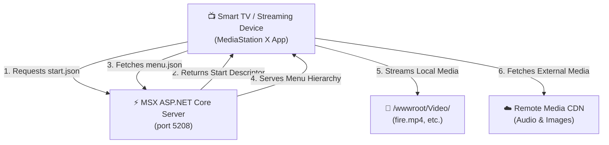

<div align="center">

# 📺 MSX - MediaStation X Server

<p align="center">
  <b>A sleek, lightweight ASP.NET Core backend for serving custom MediaStation X (MSX) media portals to Smart TVs & streaming devices.</b>
</p>

[](https://dotnet.microsoft.com/)
[](https://docs.microsoft.com/en-us/dotnet/csharp/)
[](https://msx.benzac.de/)
[](#license)

---

</div>

## 📌 Overview

**MSX Server** is a modern, high-performance ASP.NET Core application built to serve interactive media menus, video streams, audio playlists, and image galleries directly to [MediaStation X](https://msx.benzac.de/) running on Smart TVs (Samsung Tizen, LG webOS, Android TV, Fire TV) and web browsers.

With this server, you can host your own private TV portal, serve local media assets (MP4, MP3, images), and build custom cross-platform TV user interfaces effortlessly.

---

## ✨ Features

- ⚡ **Lightweight & Fast**: Powered by ASP.NET Core minimal Web API pipeline for maximum performance.
- 📺 **MediaStation X Native**: Ready-to-use endpoints for `start.json` descriptors & dynamic `menu.json` catalogs.
- 🧲 **TorrServer Integration**:
  - Direct integration with [TorrServer](https://github.com/YouROK/TorrServer).
  - Stream torrents online with peer counts, status badges, and internal file selection.
  - Automatic detection and playback of local `.torrent` files inside your media folders.
- 📁 **Folder Hierarchy Preservation**:
  - Folders remain navigable directories with automatic cover/poster discovery.
  - Alphanumeric / natural numeric sorting for files and episodes (e.g. `Episode 1`, `Episode 2`, `Episode 10`).
- 🎬 **Multi-Type Media Library**:
  - Video (`.mp4, .mkv, .avi, .mov, .webm, .ts, .m2ts`, etc.)
  - Audio (`.mp3, .m4a, .flac, .wav, .wma, .aac, .ogg`) with cover artwork
  - Photos (`.jpg, .jpeg, .png, .webp`) with image gallery viewer
- 🔖 **Webmarks / Stream Bookmarks**:
  - Save and stream direct video feeds, HLS (`.m3u8`), and YouTube videos via native MSX YouTube plugin.
- 🌌 **Video Wallpaper (Atmos)**:
  - Atmospheric background video loops (Atmos 1–6) powered by MSX background plugin.
- ⏯️ **Playback Resume & Extended Controls**:
  - Integrated `resume:key: "url"` for cross-session playback memory on TV.
  - Extended on-screen controls, scrubber, and audio track selectors.
- 🖥️ **Web Dashboard**:
  - Browser dashboard at `http://<IP>:5208` for service monitoring, system status, and adding webmarks.

---

## 🏗️ Architecture



---

## 📂 Repository Structure

```text
MSX/
├── MSX.sln                  # Visual Studio Solution File
└── MSX/                     # Main Web Project
    ├── Program.cs           # Web Server Pipeline & Static Files Setup
    ├── MSX.csproj           # .NET 8 Web Project File
    ├── appsettings.json     # Application Configuration Settings
    └── wwwroot/             # Static Assets Directory
        ├── Video/           # Local Video Files Directory
        └── msx/             # MediaStation X JSON Definitions
            ├── start.json   # Portal entry point descriptor
            └── menu.json    # Interactive menu tree & media catalog
```

---

## 🚀 Quick Start Guide

### Prerequisites
- [.NET 8.0 SDK](https://dotnet.microsoft.com/download/dotnet/8.0) or later.
- [MediaStation X App](https://msx.benzac.de/) installed on your Smart TV, media device, or tested in browser.

### 1. Run the Server
Clone the repository and run the ASP.NET Core application:

```bash
# Navigate to the web project directory
cd MSX/MSX

# Start the web server
dotnet run
```

The server will start listening on your local port:
- HTTP: `http://localhost:5208` (or your local LAN IP: `http://<YOUR_LOCAL_IP>:5208`)

---

## 📺 Connecting MediaStation X

1. Launch **MediaStation X** on your Smart TV or device.
2. Open **Settings** ⚙️ ➔ **Start Parameter** ➔ **Setup**.
3. Enter your server's `start.json` address:
   ```text
   <YOUR_SERVER_IP>:5208/msx/start.json
   ```
4. Confirm to load your custom interactive media menu!

---

## ⚙️ Configuration Details

### Entry Point (`start.json`)
The entry point instructs MediaStation X where to fetch the menu structure:

```json
{
  "name": "My Example Content",
  "version": "1.0.0",
  "parameter": "menu:http://{SERVER}/msx/menu.json"
}
```
> **Note:** `{SERVER}` is dynamically replaced by MediaStation X with the IP/host of the serving machine.

### Menu Definition (`menu.json`)
Organizes your movies, audio tracks, and photo galleries into structured interactive pages:

```json
{
  "headline": "My Example Content",
  "menu": [
    {
      "icon": "movie",
      "label": "My Example Movies",
      "data": {
        "type": "pages",
        "template": {
          "type": "separate",
          "layout": "0,0,2,4",
          "icon": "msx-white-soft:movie",
          "color": "msx-glass"
        },
        "items": [
          {
            "title": "Sample Movie",
            "action": "video:http://{SERVER}/Video/fire.mp4"
          }
        ]
      }
    }
  ]
}
```

---

## 🛠️ Customization & Media Addition

- **Adding Local Videos**: Copy your `.mp4` video files to `MSX/wwwroot/Video/` and update `items` in `MSX/wwwroot/msx/menu.json`.
- **UI Customization**: Change template properties such as `color` (`msx-glass`, `msx-dark`, `msx-blue`) or layout specs in `menu.json` to alter the TV grid display.

---

## 📄 License

This project is licensed under the [MIT License](LICENSE).
